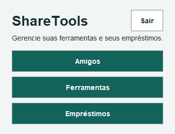
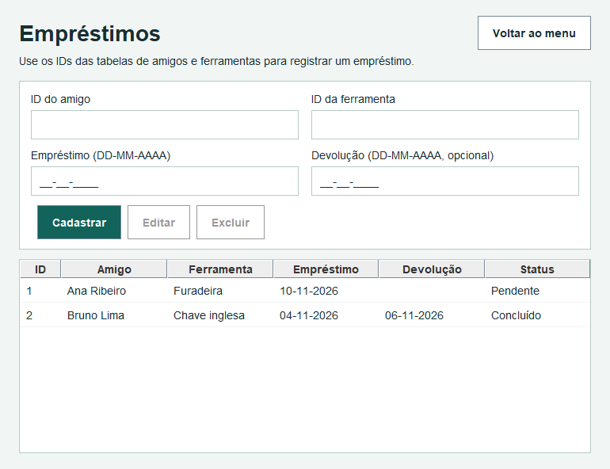

# ShareTools

**Aplicativo desktop para organizar ferramentas e acompanhar empréstimos entre amigos.**

O ShareTools registra quais ferramentas estão disponíveis, com quem estão as ferramentas emprestadas e quando elas foram devolvidas.

[Funcionalidades](#funcionalidades) · [Tecnologias](#tecnologias) · [Como executar](#como-executar) · [Arquitetura](#arquitetura)



## Funcionalidades

- **Amigos** — cadastre contatos e consulte o total de empréstimos de cada pessoa.
- **Ferramentas** — registre nome, marca e custo de aquisição. A tela exibe o investimento total do catálogo.
- **Empréstimos** — associe um amigo a uma ferramenta, acompanhe pendências e registre devoluções pelo formulário de edição.
- **Disponibilidade e histórico** — o aplicativo impede que a mesma ferramenta tenha empréstimos em datas sobrepostas e protege amigos e ferramentas vinculados ao histórico contra exclusão.



*Exemplos fictícios exibidos na interface do aplicativo.*

## Tecnologias

| Tecnologia | Uso no projeto |
| --- | --- |
| Java 17+ e Swing | Linguagem e interface gráfica desktop |
| SQL e MySQL 8.4 | Persistência dos cadastros e empréstimos |
| JDBC e MySQL Connector/J 8.4 | Comunicação entre o Java e o banco de dados |
| Apache Ant e script para Windows | Compilação e empacotamento do aplicativo |
| Docker Compose | Inicialização local do MySQL e criação do esquema |

## Como executar

Tenha um **JDK 17 ou superior**, um ambiente gráfico e o **Docker com Compose**. O driver JDBC está incluído em `lib/`.

```shell
git clone https://github.com/Takazonoo/ShareTools.git
cd ShareTools
docker compose up -d --wait
```

Na primeira execução, o Compose cria o banco `sharetools` com as tabelas vazias.

**Windows, no PowerShell**

```powershell
.\run.cmd
```

**Linux ou macOS, com Apache Ant**

```shell
ant run
```

Para gerar apenas o pacote, use `.\run.cmd --build-only` no Windows ou `ant jar`. Rode o pacote com `java -jar dist/ShareTools.jar` e mantenha `dist/lib` ao lado do JAR.

### Primeiro empréstimo

1. Cadastre um amigo e uma ferramenta nas telas correspondentes. Anote os IDs exibidos nas tabelas.
2. Abra **Empréstimos**, informe os dois IDs e preencha a data no formato `DD-MM-AAAA`. Deixe a devolução em branco para registrar um empréstimo pendente.
3. Quando a ferramenta voltar, selecione a linha do empréstimo na tabela, preencha a data de devolução e clique em **Editar**. O status muda para **Concluído**. O dia da devolução faz parte do período ocupado.

Use **Voltar ao menu** para trocar de tela. As ações **Editar** e **Excluir** ficam disponíveis ao selecionar uma linha na tabela.

### Banco de dados próprio

Com um MySQL 8.4 instalado à parte, execute [o script de criação do esquema](ScriptsSQL/scripts.sql) com uma conta administrativa. A conta do aplicativo precisa de `SELECT`, `INSERT`, `UPDATE` e `DELETE` em `sharetools.*`.

| Variável | Valor padrão local |
| --- | --- |
| `SHARETOOLS_DB_URL` | `jdbc:mysql://127.0.0.1:3306/sharetools?connectTimeout=3000&socketTimeout=5000` |
| `SHARETOOLS_DB_USER` | `develop` |
| `SHARETOOLS_DB_PASSWORD` | `develop` |

Defina as variáveis na sessão que inicia o aplicativo. Se a porta 3306 estiver ocupada, defina `SHARETOOLS_DB_PORT` antes de iniciar o Compose e use a mesma porta na URL JDBC. Na primeira criação do volume, o Compose também aceita `SHARETOOLS_MYSQL_ROOT_PASSWORD` para configurar a conta administrativa.

<details>
<summary>Migrar dados de uma versão anterior</summary>

A versão anterior usava o esquema `mysql`. Faça um backup e crie o esquema `sharetools` no servidor que contém as tabelas originais. Com a aplicação fechada e o esquema de destino vazio, execute [o script de migração](ScriptsSQL/migrar-legado.sql) em modo batch, sem `--force`, com acesso aos dois esquemas. A migração preserva os identificadores e calcula o status de cada empréstimo a partir da data de devolução. Para transferir os dados a outro servidor, exporte o esquema `sharetools` após a migração.

</details>

## Arquitetura

```text
src/
├── Principal/   Ponto de entrada da aplicação
├── View/        Telas Swing e validação de entrada
├── Model/       Entidades Amigo, Ferramenta e Emprestimo
├── DAO/         Conexão JDBC, consultas e gravação
└── Imagens/     Recursos gráficos da aplicação
ScriptsSQL/     Criação do esquema e migração dos dados
```

A interface valida os dados de entrada e delega a persistência aos DAOs. No banco, cada empréstimo referencia um amigo e uma ferramenta por chaves estrangeiras. Ao salvar um empréstimo, o DAO bloqueia o registro da ferramenta em uma transação, verifica se as datas conflitam e só então grava. O total por amigo é calculado a partir dos empréstimos cadastrados.

## Equipe

Caio Gevaerd Wurzler · Thiago Henrique Teles Alves · Diego Fabro Cândido · Vinicius da Silva Takazono · Carlos Eduardo Ely
